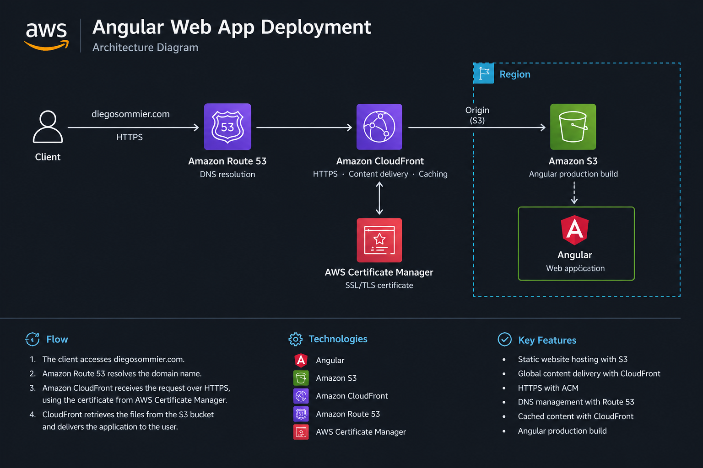

# Angular Web App Deployment

Deployment of my personal portfolio website using AWS services, with a focus on cloud infrastructure, content delivery, DNS management and HTTPS.

🌐 **Live website:** [https://diegosommier.com](https://diegosommier.com)

## 📖 Overview

This project covers the deployment of my personal portfolio website using a cloud-based architecture on AWS. The application was built with Angular and deployed as a static website, using Amazon S3 for storage and Amazon CloudFront for content delivery.

Amazon Route 53 manages DNS resolution for the custom domain, while AWS Certificate Manager (ACM) provides the SSL/TLS certificate required to enable secure HTTPS access.

The project demonstrates how AWS services can be combined to publish a web application securely and make it accessible through a custom domain.

### 🎓 Training Context

This project was developed as part of the **Cloud Computing and DevOps Bootcamp by [BlockStellart](https://learn.blockstellart.com/bootcamp/)**. It applies concepts covered during the training to the deployment of an Angular web application and my personal portfolio.

## 🏗️ Architecture



The deployment uses the following AWS services:

- **Amazon S3:** Stores the compiled Angular application files.
- **Amazon CloudFront:** Distributes website content through AWS edge locations.
- **Amazon Route 53:** Manages DNS records for the custom domain.
- **AWS Certificate Manager (ACM):** Provides the SSL/TLS certificate used to enable HTTPS.

### Request Flow

1. A visitor accesses `diegosommier.com`.
2. Amazon Route 53 resolves the domain to the CloudFront distribution.
3. Amazon CloudFront serves the website content over HTTPS.
4. The compiled Angular application files are stored in Amazon S3 and used to deliver the website.

## 🔧 Infrastructure & Implementation

### 1. Angular Application Build

The Angular application was compiled into static files suitable for deployment.

```bash
npx ng build
```

The generated output is located in the `dist/` directory. Depending on the Angular build configuration, the deployable files may be inside a nested `browser/` directory.

### 2. Amazon S3

An S3 bucket was used to store the compiled application files.

The deployment process involves uploading the generated build output rather than the original Angular source code.

### 3. Amazon CloudFront

A CloudFront distribution was configured to deliver the website content through AWS's content delivery network.

CloudFront improves content delivery performance and supports HTTPS access through the configured custom domain and certificate.

### 4. AWS Certificate Manager (ACM)

An SSL/TLS certificate was requested and validated through AWS Certificate Manager for the custom domain.

The certificate enables encrypted HTTPS connections between visitors and the CloudFront distribution.

### 5. Amazon Route 53

Route 53 was used to manage the DNS records required to connect the custom domain to the CloudFront distribution.

DNS configuration and certificate validation were important steps in making the website accessible through the custom domain.

### 6. Cache Invalidation

After deploying updated application files, a CloudFront cache invalidation was used to ensure that visitors received the latest version of the website.

```text
/*
```

Invalidating the relevant cached content helped resolve an issue where the previous version of the website continued to appear after deployment.

## 🛠️ Technologies & Tools

- **Cloud provider:** Amazon Web Services (AWS)
- **Frontend framework:** Angular
- **Programming language:** TypeScript
- **Object storage:** Amazon S3
- **Content delivery network:** Amazon CloudFront
- **DNS management:** Amazon Route 53
- **SSL/TLS certificates:** AWS Certificate Manager (ACM)
- **Version control:** Git and GitHub

## 🚀 Deployment

The deployment workflow consists of the following steps:

1. Develop and test the Angular application locally.
2. Build the application into static production files.
3. Upload the generated files to the Amazon S3 bucket.
4. Configure CloudFront to deliver the application content.
5. Configure the custom domain through Route 53.
6. Validate and associate the SSL/TLS certificate with CloudFront.
7. Invalidate the CloudFront cache after updates when required.
8. Verify that the website is accessible through the custom domain over HTTPS.

## 📚 Documentation

Official AWS documentation:

- [Amazon S3](https://docs.aws.amazon.com/s3/)
- [Amazon CloudFront](https://docs.aws.amazon.com/cloudfront/)
- [Amazon Route 53](https://docs.aws.amazon.com/route53/)
- [AWS Certificate Manager](https://docs.aws.amazon.com/acm/latest/userguide/acm-overview.html)

Additional resources:

- [Angular documentation](https://angular.dev/)
- [BlockStellart — Cloud Computing and DevOps Bootcamp](https://learn.blockstellart.com/bootcamp/)

## ⚠️ Project Context

This is a personal learning project developed as part of my transition from systems administration towards cloud infrastructure and architecture.

The deployment provided practical experience with AWS services, static web application hosting, DNS configuration, HTTPS, content delivery and cache management.

The project is intended to document my learning journey and demonstrate the practical application of cloud concepts.

## ☁️ From Systems Administration to Cloud

With a background in systems administration, I am expanding my skills towards cloud infrastructure, automation and architecture.

Projects like this portfolio deployment allow me to apply my existing infrastructure knowledge in AWS and build a practical foundation for more advanced cloud projects.

---

**Author:** Diego Sommier  
**Focus:** Cloud Computing · AWS · Infrastructure  
**Year:** 2026
